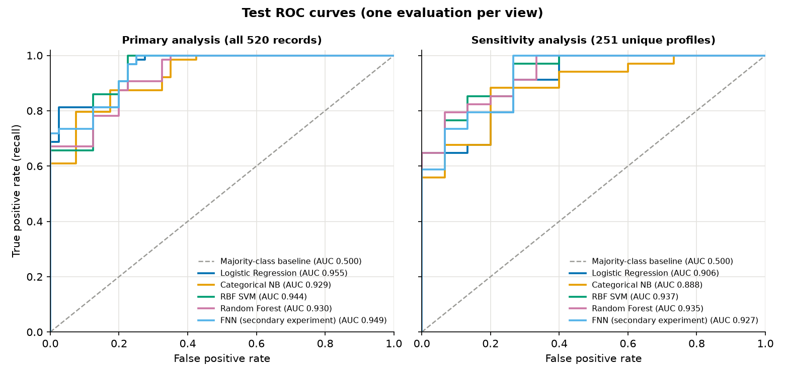

# Diabetes Questionnaire Data: a Leakage-Aware Classification Study

*By [SHISHIR MD SHIFAT HOSSAIN](https://github.com/shishir9005)*

An educational data-science project on the UCI [*Early Stage Diabetes Risk Prediction*](https://archive.ics.uci.edu/dataset/529/early+stage+diabetes+risk+prediction+dataset) dataset: 520 questionnaire records with 16 features (age, gender and 14 yes/no symptom answers) and a Positive/Negative label. The aim is not a high score. It is a careful, honest evaluation of a small dataset in which about half of the rows are exact copies of other rows.

> **Educational use only.** This project is for educational purposes only. It is not a medical device and does not provide a diagnosis or medical advice. Its predictions should not be used to make healthcare decisions. Please consult a qualified healthcare professional if you have concerns about diabetes.

- Narrative analysis, executed so it can be read without running anything: [`notebooks/clinical_diabetes_analysis.ipynb`](notebooks/clinical_diabetes_analysis.ipynb)
- Detailed results report: [`reports/09_model_results.md`](reports/09_model_results.md)
- Methodology and decisions: [`docs/PROJECT_PLAN.md`](docs/PROJECT_PLAN.md)
- Interactive app, run locally: see [Run the app locally](#run-the-app-locally)

## Highlights

- **Data work.** Validation of the downloaded file against the UCI documentation, deterministic cleaning, an audit of exact duplicate rows (520 rows, 251 distinct profiles), and SQL (SQLite) plus exploratory analysis on the training rows only.
- **Leakage-aware design.** A frozen train/test split and 15 cross-validation folds, all grouped so that identical rows never sit on both sides of a split, with preprocessing fitted inside each training fold.
- **Pre-declared selection, one test evaluation.** The model-selection rule was written before any result existed, the choice was saved and hashed before the test rows were opened, and the test set was used once per analysis, with bootstrap intervals that resample whole groups.
- **Five models, an honest outcome.** A majority-class baseline, Logistic Regression, Categorical Naive Bayes, an RBF SVM and a Random Forest were compared by cross-validated ROC-AUC, with a small PyTorch network as a secondary experiment. Their test intervals overlap heavily, so the results do not show that any one model is better. The RBF SVM was chosen by the pre-declared rule, not because it won.
- **Reproducibility.** Pinned requirements, an executed notebook, and a SHA-256 manifest of the frozen inputs and results.
- **A small local Streamlit app** that presents the saved tables and figures and an educational prediction form that returns only a class, with automated tests. The form uses a separate, demo-only Logistic Regression whose saved file was inspected and holds no training rows (see [Models in this project](#models-in-this-project)).

## Run the app locally

The app shows this project's saved tables and figures, and an educational prediction form that uses a small demo-only Logistic Regression, not the research-selected SVM (see [Models in this project](#models-in-this-project)). It reads only files that are in the repository (`reports/`, `models/`), needs no dataset files, and writes nothing.

Run these from the project folder (Python 3.12):

```bash
python -m venv .venv
source .venv/bin/activate
python -m pip install -r requirements.txt
streamlit run app/streamlit_app.py
```

The app opens at <http://localhost:8501>. Press Ctrl+C in the terminal to stop it.

- **Pages:** Overview, Exploratory analysis, Model comparison, Evaluation, Educational prediction. The tables are the report's own tables, and the figures are the saved figures.
- **Prediction page:** the 16 answers (age, gender and 14 yes/no symptoms) are validated, then the demo-only Logistic Regression returns one class, *Positive* or *Negative*, and nothing else: no probability, score or advice. Use made-up answers or the two built-in synthetic examples. The app does not store or log what is entered and makes no network calls.
- **Model file check:** the model is a pickle, which can run code when loaded, so the app compares it with the SHA-256 recorded when it was saved before loading it. It also refuses any model that is not a plain Logistic Regression (for example, one that carries support vectors). If the file is missing, changed, or needs a different scikit-learn version, the page shows a message instead of predicting.
- **Local-only settings:** start the app from the project folder so that Streamlit reads `.streamlit/config.toml`. It turns off Streamlit's usage statistics and first-run email prompt, and makes the server listen on this computer only (by default Streamlit listens on every network interface, so other devices on your Wi-Fi could reach it). Do not start it with `--server.headless true` if you want no network lookups at all: in that mode Streamlit itself asks an external service for the machine's public IP address to print an "External URL".
- **Browser pop-up:** `streamlit run` opens your default browser by itself. Streamlit 1.67 may show a pop-up there, "Help agents write better Streamlit apps", when it finds an AI-agent folder such as `~/.claude` in your home folder. It is not part of this app and can be ignored. Its Install button makes Streamlit create links in `.claude/skills/` and `.agents/skills/` inside the project folder, pointing into your Python environment; `.gitignore` keeps them out of Git.
- **Tests:** `python -m unittest discover -s tests -v` (same environment). They check the demo model and its input order, that its saved file holds no training records, valid and invalid inputs, that the pages show the saved report's numbers, and that the files Git would publish contain no local paths, secrets or e-mail addresses.

## Results at a glance

There are 520 rows but only 251 distinct questionnaire profiles, and the file has no patient identifier, so there is no way to tell whether identical rows are repeated entries or different people with the same answers. Nothing is removed from the main analysis. Every result is reported twice:

- **Primary analysis:** all 520 records (416 training rows; 104 test rows from 49 profile groups, 64 Positive and 40 Negative).
- **Sensitivity analysis:** the 251 unique questionnaire profiles (202 training rows; 49 test rows, 34 Positive and 15 Negative).

Cross-validation is mean ± SD over the 15 grouped folds of the training data. The test column comes from a single evaluation, with 95% group-bootstrap intervals in brackets.

| Model | CV ROC-AUC, primary | Test ROC-AUC, primary | CV ROC-AUC, sensitivity | Test ROC-AUC, sensitivity |
|---|---|---|---|---|
| Majority-class baseline | 0.500 ± 0.000 | 0.500 | 0.500 ± 0.000 | 0.500 |
| Logistic Regression | 0.963 ± 0.025 | 0.955 [0.854, 0.995] | 0.961 ± 0.026 | 0.906 [0.808, 0.976] |
| Categorical Naive Bayes | 0.949 ± 0.031 | 0.929 [0.792, 0.990] | 0.951 ± 0.030 | 0.888 [0.792, 0.969] |
| **RBF SVM (chosen)** | 0.978 ± 0.022 | 0.944 [0.822, 0.997] | 0.981 ± 0.016 | 0.937 [0.859, 0.991] |
| Random Forest | 0.984 ± 0.014 | 0.930 [0.794, 0.991] | 0.981 ± 0.018 | 0.935 [0.857, 0.988] |
| Small neural network (secondary) | 0.959 ± 0.028 | 0.949 [0.833, 0.996] | 0.961 ± 0.024 | 0.927 [0.838, 0.988] |

Test metrics of the chosen model (RBF SVM), threshold fixed in advance:

| Metric | Primary (104 test rows) | Sensitivity (49 test rows) |
|---|---|---|
| Accuracy | 0.856 [0.716, 0.951] | 0.816 [0.714, 0.918] |
| Precision | 0.877 [0.706, 1.000] | 0.879 [0.756, 0.971] |
| Recall | 0.891 [0.786, 0.971] | 0.853 [0.727, 0.969] |
| Specificity | 0.800 [0.454, 1.000] | 0.733 [0.500, 0.938] |
| F1 | 0.884 [0.772, 0.959] | 0.866 [0.769, 0.943] |
| ROC-AUC | 0.944 [0.822, 0.997] | 0.937 [0.859, 0.991] |
| Confusion matrix (TN / FP / FN / TP) | 32 / 8 / 7 / 57 | 11 / 4 / 5 / 29 |



How to read these numbers:

- **The models cannot be separated.** The intervals overlap heavily, so these results do not show that any one model is better than another. The selection rule picked the RBF SVM in both analyses, although the cross-validation ranking at the top differs (Random Forest first in the primary analysis, RBF SVM first in the sensitivity analysis).
- **Accuracy alone is misleading here.** A model that answers Positive for every row would score 0.615 accuracy on the primary test set (0.694 on the sensitivity test set). It has ROC-AUC 0.5 and specificity 0, which is why ROC-AUC and specificity are reported.
- **Specificity is the least certain number.** The test sets contain only 40 (primary) and 15 (sensitivity) Negative rows.
- **Test scores are below cross-validation scores** for every model. That is the direction expected when cross-validation also chose the configurations, but with test sets this small the size of the gap is itself uncertain.
- **These are scores on one hospital's questionnaire sample.** They are not evidence of clinical usefulness (see Limitations).

## Models in this project

Two different saved models belong to this project, and they are not the same model: the research-selected RBF SVM, and a demo-only Logistic Regression that the app uses.

| Aspect | Research-selected model | Demo-only model |
|---|---|---|
| Algorithm | RBF SVM (`C = 1`, `gamma = 0.1`) | Logistic Regression (`C = 0.1`) |
| Role | Picked by the pre-declared selection rule in both analyses. Its test results are the "chosen model" results above. | Used only by the app's *Educational prediction* page, to show the output format. It was not selected and is not claimed to be better. |
| Configuration | Chosen by cross-validation on the training data | The configuration cross-validation chose for Logistic Regression in the primary analysis. No new tuning. |
| Fitted on | The 416 training rows of the primary analysis | The same 416 training rows. No test row was read. |
| Evaluated | Once on the test set (table above) | Not separately. The report's Logistic Regression row evaluated this configuration once on the test set; the demo file itself was not evaluated. |
| Saved file | `models/primary_demo_pipeline.joblib`, **not published** | `models/demo_logistic_regression.joblib`, published (3,505 bytes) |
| What the file contains | 127 of the 416 training rows, stored as support vectors | 16 coefficients, an intercept, the age scaling, the class labels and the column names |

**Why two models.** An RBF SVM keeps its support vectors, which are copies of training rows, inside the saved file. The SVM file holds each stored record's standardised age, gender and 14 yes/no symptom answers, its class (the sign of its coefficient) and its position in the training partition, so 127 of the 416 training rows (and none of the test rows) can be read back out of it. This project does not publish row-level data, so that file stays on the author's computer, `.gitignore` excludes it, and the app does not use it. A Logistic Regression stores only coefficients, so its file can be published and used by the app.

**Wording in the frozen research files.** `reports/09_model_results.md`, the selection rule saved in `reports/model_selection.json`, the `demo_pipeline` entry in `reports/model_test_results.json`, and the scripts that write them (`src/s08_cv_select.py`, `src/s09_test_eval.py`, `src/s11_build_report.py`) were finished before the app switched to a different model. Their SHA-256 values are recorded, so they are kept exactly as they were. They use "demo model" and "demo pipeline" for the research-selected RBF SVM (`models/primary_demo_pipeline.*`). Read those words as follows: **the RBF SVM is the research-selected model; Logistic Regression is used separately for the public Streamlit demonstration; and the original SVM file stays on the author's computer because it contains training records.** In this README and in the app's own text, "demo model" means that Logistic Regression.

**Research results are unchanged.** The demo model was added after the research was finished. The frozen split and folds, the cross-validation and test results, the selection record and the saved RBF SVM were not modified. Their SHA-256 values in `reports/sha256_manifest.txt` are the ones recorded before the demo model existed.

**How the "no training rows in the file" claim was checked.** It rests on what is inside the file, not on the type of model. `src/s12_demo_model.py` fits the model, serialises it in memory, loads those bytes again and inspects them before anything is written:

1. Every class the file refers to is recorded: only scikit-learn, NumPy and joblib classes, no custom code.
2. Every array and attribute of the loaded object is listed: 10 arrays holding 55 values in total, the largest being the 16 coefficients. There are no support vectors, row indices, tree structures or other per-row attributes.
3. Every stored numeric array is searched for each of the 416 training rows, both as raw answers and as standardised values: none is found.
4. The file is written only if all of this passes. The tests repeat the inspection on the published file, and include a control showing that the same search does find the stored rows of an SVM fitted to invented data.

This shows that the file contains no training rows, support vectors or per-row values. It is not a claim of anonymity beyond that: the coefficients are fitted from the training rows, as in any model.

## How the evaluation avoids common mistakes

- **Identical rows on both sides of a split.** Rows with the same 16 answers form one group, and splitting and cross-validation use scikit-learn's `StratifiedGroupKFold` on those groups. The notebook shows why: with ordinary row-wise 5-fold cross-validation on the training data, 68% of validation rows have an identical row in the training part, and ROC-AUC comes out 0.011 to 0.015 higher than with grouped folds for Logistic Regression, RBF SVM and Random Forest. Row-wise folds are shown as an illustration only and are never used to choose anything.
- **Looking at the test set early.** The split and the folds were frozen before any model was trained. Models were chosen on the training data only. The selection was written to a file and its SHA-256 recorded, and only then were the test rows opened, once per analysis. No test result changed a choice.
- **Selection after seeing results.** The rule was declared before any result existed. Within each model the configuration with the best mean cross-validated ROC-AUC is taken. Across models, every model within one standard deviation of the best (of the best model's 15 fold scores) is eligible, and the simplest eligible model wins (Logistic Regression, then Categorical Naive Bayes, then RBF SVM, then Random Forest).
- **Preprocessing leakage.** Age scaling is inside scikit-learn pipelines and is fitted on each training fold only. The age bands for Naive Bayes are fixed edges, so nothing is learned from the data.
- **Misleading baselines and metrics.** The majority-class baseline has ROC-AUC exactly 0.5. A metric with 0/0 would be reported as undefined, never as zero; none occurred. No threshold tuning, class weighting or resampling was used.
- **Overconfident intervals.** Bootstrap intervals resample whole profile groups, not single rows, because identical rows receive identical predictions and are not independent.
- **Uncalibrated probabilities.** No calibration was done, so the models are used only to predict a class, and no numeric probabilities are shown.
- **The neural network.** It is a secondary experiment. It used the same folds and test set, took no part in selection, and its epoch count was chosen by early stopping on a group-separated inner split before a fresh network was retrained on the whole training fold for exactly that many epochs.

## Repository layout

```
.
├── README.md
├── LICENSE                     # MIT licence for the code and documentation (not for the dataset)
├── requirements.txt            # packages for the app and the tests, pinned (Python 3.12)
├── requirements-analysis.txt   # adds the notebook and the analysis scripts
├── requirements-fnn.txt        # adds PyTorch, only for the optional neural network
├── app/                        # Streamlit app (entry point: streamlit_app.py)
├── .streamlit/config.toml      # telemetry off, error details off, localhost only, theme
├── tests/test_app.py           # tests for the app, the demo model and the release rules
├── notebooks/
│   └── clinical_diabetes_analysis.ipynb
├── src/                        # scripts, see below
├── sql/train_queries.sql       # SQL run on the training rows only
├── reports/                    # numbered reports, result tables, figures, SHA-256 manifest
├── models/                     # the demo-only Logistic Regression and its description
└── docs/                       # PROJECT_PLAN.md, DATA_SOURCE.md
```

**Not published.** The row-level files stay out of the repository: `data/` (the raw UCI download, the processed CSVs, and the train/test and fold assignments). So do databases, private environment reports and working notes, an `archive/` of earlier file versions, and the research-selected RBF SVM (`models/primary_demo_pipeline.*`), which stores training rows (see [Models in this project](#models-in-this-project)). Some reports and scripts still mention these paths, because they describe the original working folder.

| Script | Purpose |
|---|---|
| `s00_smoke_test.py` to `s07_verify_correction.py` | Environment check, validation of the raw file, cleaning and duplicate audit, frozen split and CV folds, SQL and EDA on training rows, integrity checks. They were run when the inputs were frozen, and several refuse to overwrite existing outputs. |
| `rebuild_processed_data.py` | Rebuilds `data/processed/` from the raw download and the split assignment, and checks every SHA-256. |
| `s08_cv_select.py` | Cross-validated model selection on the training data only. |
| `s09_test_eval.py` | Verifies the selection hash, then runs the single test evaluation and saves the selected RBF SVM (`models/primary_demo_pipeline.*`, kept local). |
| `s10_fnn.py` | Optional neural network (needs PyTorch). |
| `s11_build_report.py` | Builds `reports/09_model_results.md` and its figures from the saved results. |
| `s12_demo_model.py` | Fits the demo-only Logistic Regression on the training rows with the configuration that cross-validation chose, inspects what its serialised file contains, and writes `models/demo_logistic_regression.*` only if nothing in it could be a stored record. Refuses to overwrite. |
| `mlcommon.py`, `prep.py` | Shared helpers and constants. |

`reports/sha256_manifest.txt` lists the SHA-256 of every file in the original working folder, including files that are not published. In a clone, `shasum -a 256 -c reports/sha256_manifest.txt` reports those (everything in `data/` and `archive/`, the private reports and the research SVM) as missing.

## Reproduce the analysis

The app and the executed notebook can be used from a clone. Re-running the notebook and the analysis scripts needs the row-level files in `data/`, which are not published (see Repository layout), so the steps below apply to the full working copy. Run them from the project folder.

**1. Install the packages** (Python 3.12):

```bash
python -m venv .venv
source .venv/bin/activate
python -m pip install -r requirements-analysis.txt
```

**2. Get the raw data.** It is not stored in the repository. The download link and the expected SHA-256 values are in [`docs/DATA_SOURCE.md`](docs/DATA_SOURCE.md).

```bash
mkdir -p data/raw/archive data/raw/extracted
curl -L -o data/raw/archive/early_stage_diabetes_risk_prediction_uci529.zip \
  "https://archive.ics.uci.edu/static/public/529/early+stage+diabetes+risk+prediction+dataset.zip"
unzip data/raw/archive/early_stage_diabetes_risk_prediction_uci529.zip -d data/raw/extracted
shasum -a 256 data/raw/archive/*.zip data/raw/extracted/*.csv
```

The two hashes should be `67594c0f11257688b57493798e70737b7156ba37a2e6ac75507ae3a35221a388` (zip) and `7889d9d0beb7dd1ccc58da99f72763f16afb259b5dbbaa086f8195366ff66137` (CSV). On Linux use `sha256sum`.

**3. Rebuild the processed files** if `data/processed/` is missing. This needs the frozen split assignment, `data/splits/split_assignment.csv`, which is one of the unpublished row-level files. The script refuses to overwrite existing files:

```bash
python src/rebuild_processed_data.py
```

**4. Open the notebook:**

```bash
jupyter lab notebooks/clinical_diabetes_analysis.ipynb
```

The notebook recomputes the analyses that use only the training rows (exploratory analysis, SQL, the grouped-versus-row-wise demonstration, the Logistic Regression coefficients). It also refits the four chosen configurations on the frozen folds and checks that the cross-validation scores match the saved ones exactly. It only displays the saved test and neural-network results, and it never opens the test rows.

**5. Optionally, re-run the experiments.** These scripts overwrite files in `reports/` and `models/`, so use a copy of the project if you want to keep the originals. The test evaluation was run once for the reported results; re-running it reproduces those numbers and should not be used for further model selection.

```bash
python src/s08_cv_select.py
python src/s09_test_eval.py
python -m pip install -r requirements-fnn.txt   # only for the optional neural network
python src/s10_fnn.py
python src/s11_build_report.py
```

**6. Optionally, rebuild the demo model.** The script refuses to overwrite `models/demo_logistic_regression.*`, so run it in a copy of the project from which those two files were removed:

```bash
python src/s12_demo_model.py
```

## Data source and citation

- **Dataset:** Early Stage Diabetes Risk Prediction [Dataset]. (2020). UCI Machine Learning Repository. https://doi.org/10.24432/C5VG8H. Licence: [CC BY 4.0](https://creativecommons.org/licenses/by/4.0/).
- **Collection, as stated by UCI:** direct questionnaires given to patients of Sylhet Diabetes Hospital in Sylhet, Bangladesh, and approved by a doctor.
- **Introductory paper listed by UCI:** Islam, M. M. F., Ferdousi, R., Rahman, S., & Bushra, H. Y. (2020). Likelihood prediction of diabetes at early stage using data mining techniques. In *Computer Vision and Machine Intelligence in Medical Image Analysis* (pp. 113–125). Springer Singapore. https://doi.org/10.1007/978-981-13-8798-2_12
- The files in `data/processed/` and `data/splits/` (not published) are adaptations of the dataset (recoded, with added identifiers and split labels) and carry the same attribution. So does the research-selected RBF SVM, `models/primary_demo_pipeline.joblib` (not published): it stores 127 of the 416 training rows as support vectors. The published demo model holds only fitted coefficients (see [Models in this project](#models-in-this-project)).

## Licence

The code and the documentation written for this project are released under the [MIT licence](LICENSE), Copyright (c) 2026 SHISHIR MD SHIFAT HOSSAIN.

The MIT licence does not cover the dataset. The UCI *Early Stage Diabetes Risk Prediction* data belong to their authors and are licensed by UCI under [CC BY 4.0](https://creativecommons.org/licenses/by/4.0/). This repository does not contain the dataset and makes no claim to it. The reports and figures hold results derived from it, and the demo model is a model fitted to it, so they keep its attribution: cite the dataset as above, and say that changes were made.

## Limitations

- **One hospital, questionnaire data.** UCI does not state how the label was determined or how patients were selected, so the results say nothing about other populations, and nothing about electronic health records or laboratory tests.
- **Small sample and identical rows.** 520 rows, 251 distinct profiles, and test sets of 104 rows (49 profile groups) and 49 rows. Intervals are wide, and a single hold-out split is one draw of which profiles land in the test set.
- **Identical rows cannot be interpreted.** They may be repeated entries, copies, or different people with the same answers. This is why both analyses are reported.
- **The features are largely symptoms.** Several items, such as polyuria and polydipsia, are classic symptoms of established diabetes, so a high score may reflect recognising symptom patterns rather than anticipating future disease. The documentation does not say when the symptoms occurred relative to the label.
- **Age.** The documented range is 20 to 65, but 52 rows fall outside it (ages 16 to 90). They were kept and reported.
- **Cross-validation is mildly optimistic,** because the same folds chose the configurations and the model. The bootstrap intervals describe uncertainty given the fitted models and the frozen test split, not the uncertainty of model selection.
- **No external validation.** Nothing here was checked on data from another source.
- **The app is a demonstration.** Its prediction page uses a small Logistic Regression that is not the selected model and was not evaluated as a separate file. Its output is a label from this dataset's own labelling, not an assessment of any person.

## Author

[SHISHIR MD SHIFAT HOSSAIN](https://github.com/shishir9005)

## Status

Finished: data validation, duplicate audit, frozen split and folds, SQL and EDA on the training rows, model comparison, single test evaluation, optional neural network, notebook, this README, and a local Streamlit app with a row-free demo model and tests. Not done: deployment and external validation.
