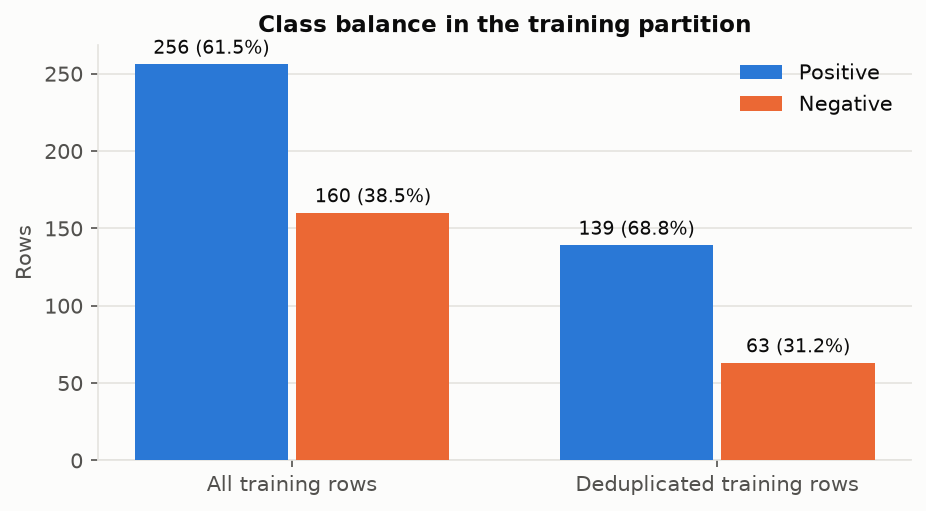
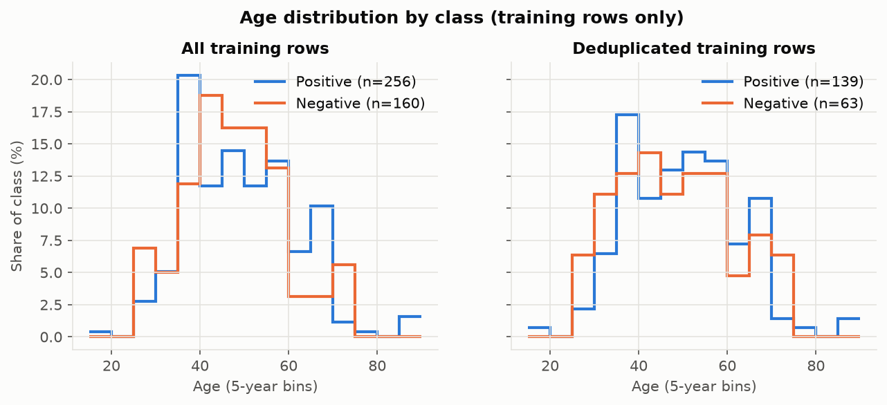
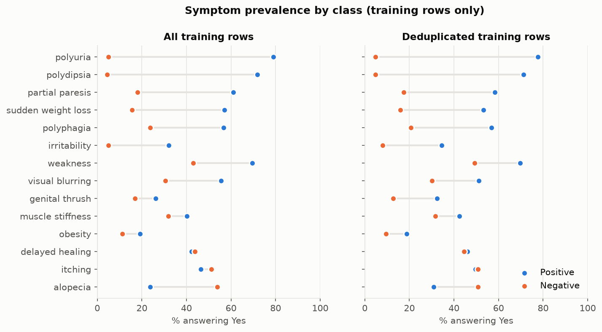
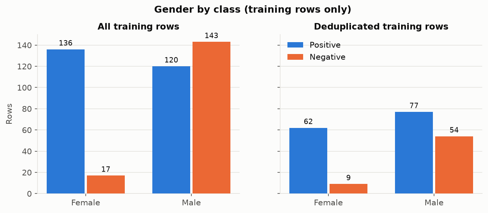

# 05 · Exploratory data analysis (training rows only)

Input: `data/processed/train_rows.csv` only (416 rows; 202 after deduplication). **No test rows were read.**
Every figure shows two views: 'All training rows' is the primary analysis (all records) and 'Deduplicated training rows' is the sensitivity analysis (one record per unique questionnaire profile).
All results are descriptive. Nothing was fitted, selected or engineered.

*Class counts in the training partition, all rows versus deduplicated.*

*Age distribution within each class, shown as the share of that class in each 5-year bin.*

*Percentage answering Yes to each symptom, by class. Symptoms are sorted by the Positive − Negative gap in the all-rows view.*

*Row counts by gender and class.*

## Symptom gap: Positive minus Negative, percentage points

| index | All training rows: Positive − Negative (pp) | Deduplicated training rows: Positive − Negative (pp) |
|---|---|---|
| polyuria | 73.9 | 72.9 |
| polydipsia | 67.5 | 66.5 |
| partial_paresis | 42.8 | 40.8 |
| sudden_weight_loss | 41.4 | 37.4 |
| polyphagia | 32.9 | 36.2 |
| irritability | 27.0 | 26.6 |
| weakness | 26.4 | 20.6 |
| visual_blurring | 24.8 | 20.9 |
| genital_thrush | 9.3 | 19.7 |
| muscle_stiffness | 8.4 | 10.7 |
| obesity | 7.9 | 9.2 |
| delayed_healing | -1.6 | 1.6 |
| itching | -4.8 | -1.2 |
| alopecia | -29.9 | -19.9 |

## Age by class

| view | class | count | mean | median | min | max |
|---|---|---|---|---|---|---|
| All training rows | Negative | 160.0 | 47.2 | 46.0 | 26.0 | 72.0 |
| All training rows | Positive | 256.0 | 48.8 | 48.0 | 16.0 | 90.0 |
| Deduplicated training rows | Negative | 63.0 | 47.6 | 46.0 | 26.0 | 72.0 |
| Deduplicated training rows | Positive | 139.0 | 49.3 | 49.0 | 16.0 | 90.0 |

## Gender by class

| view | gender | rows | positive | pct_positive |
|---|---|---|---|---|
| All training rows | Female | 153 | 136 | 88.9 |
| All training rows | Male | 263 | 120 | 45.6 |
| Deduplicated training rows | Female | 71 | 62 | 87.3 |
| Deduplicated training rows | Male | 131 | 77 | 58.8 |

## Reading notes

- These are associations within one hospital's questionnaire sample. They are not causal and
  are not population prevalence.
- Where the two views differ, the difference comes from the identical questionnaire records, which the primary
  analysis keeps and the sensitivity analysis counts once. The approved duplicate policy is in docs/PROJECT_PLAN.md §3.5.
- No feature-selection or preprocessing decision has been made from these plots. Age bands for
  Categorical NB were fixed in the plan (§3.10) before the EDA.
