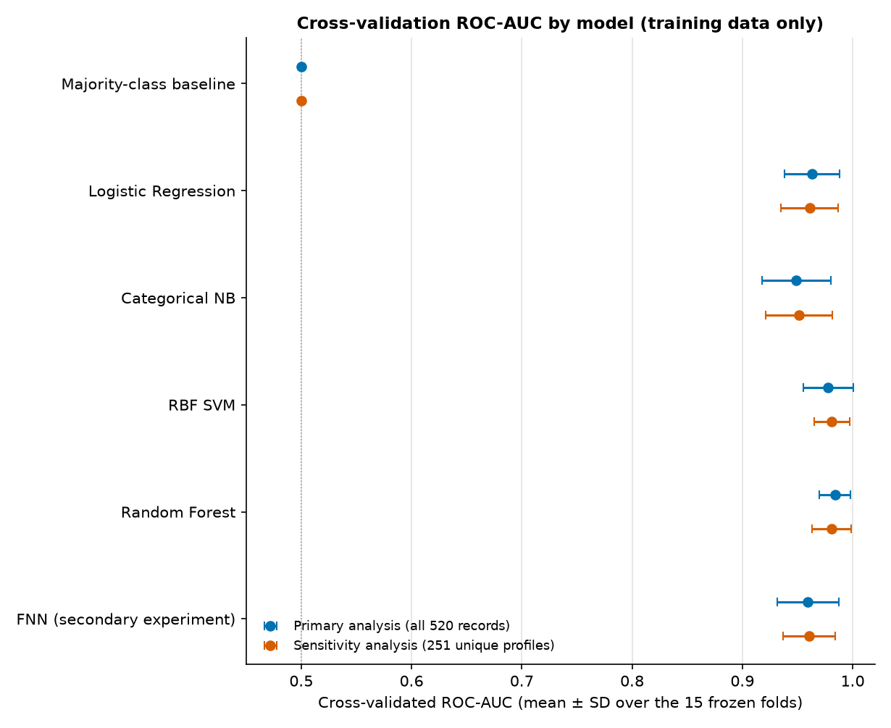
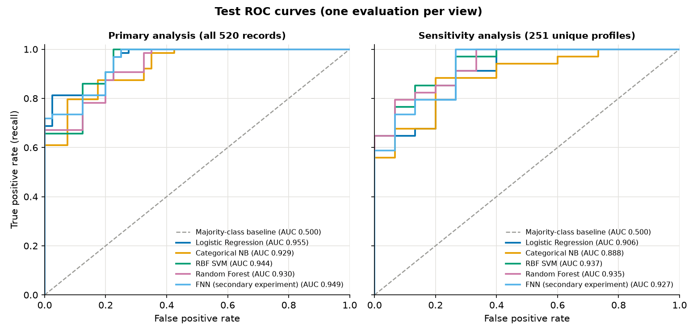

# 09 · Model results: primary and sensitivity analysis

Generated by `src/s11_build_report.py` from the saved result files. Models were selected by cross-validation on the training data only (`src/s08_cv_select.py`) and evaluated once on the frozen test set (`src/s09_test_eval.py`), with the optional FNN in `src/s10_fnn.py`.

**Views.** Primary = all 520 records (416 training rows; 104 test rows from 49 profile groups). Sensitivity = the 251 unique questionnaire profiles (202 training rows; 49 test rows). Both use the frozen train/test split and the 15 frozen cross-validation folds (3 repeats x 5 folds, seeds 0, 1, 2), assigned per profile, so no profile is on both sides of any boundary. Positive = the dataset label Positive. Predictions use threshold 0.5 (SVM: decision value 0). F1 is 2TP / (2TP + FP + FN).

## Summary

- **Chosen by the declared rule:** primary = **RBF SVM**; sensitivity = **RBF SVM** (the two views agree).
- **Cross-validation ranking of the four models** (ROC-AUC, best first): primary = Random Forest > RBF SVM > Logistic Regression > Categorical NB; sensitivity = RBF SVM > Random Forest > Logistic Regression > Categorical NB (different order).
- **Test ROC-AUC of the chosen demo model** (RBF SVM, primary view): 0.944 [0.822, 0.997]; sensitivity view, RBF SVM: 0.937 [0.859, 0.991].
- **Demo pipeline saved:** `models/primary_demo_pipeline.joblib` (RBF SVM, {"C": 1, "gamma": 0.1}); the reloaded pipeline gives identical test predictions and identical scores.
- **Baseline:** the majority-class baseline predicts Positive for every row, so its ROC-AUC is exactly 0.5 in every fold and on both test sets.
- **FNN (secondary experiment):** test ROC-AUC 0.949 [0.833, 0.996] (primary) and 0.927 [0.838, 0.988] (sensitivity), from seed-averaged probabilities. It took no part in model selection and is not deployed.

## 1. Cross-validation results (training data only)

Mean ± SD over the 15 frozen validation folds, for the configuration chosen within each model. The SD is the spread across overlapping folds, not a confidence interval.

### Primary analysis (all 520 records)

| Model | Selected configuration | Accuracy | Precision | Recall | Specificity | F1 | ROC-AUC |
|---|---|---|---|---|---|---|---|
| Majority-class baseline | most frequent class | 0.615 ± 0.002 | 0.615 ± 0.002 | 1.000 ± 0.000 | 0.000 ± 0.000 | 0.762 ± 0.001 | 0.500 ± 0.000 |
| Logistic Regression | C=0.1 | 0.905 ± 0.038 | 0.940 ± 0.049 | 0.906 ± 0.063 | 0.902 ± 0.083 | 0.921 ± 0.032 | 0.963 ± 0.025 |
| Categorical NB | alpha=1.0 | 0.884 ± 0.051 | 0.944 ± 0.051 | 0.866 ± 0.080 | 0.912 ± 0.081 | 0.901 ± 0.046 | 0.949 ± 0.031 |
| RBF SVM | C=1, gamma=0.1 | 0.922 ± 0.036 | 0.959 ± 0.034 | 0.914 ± 0.060 | 0.935 ± 0.055 | 0.935 ± 0.031 | 0.978 ± 0.022 |
| Random Forest | max_depth=5, min_samples_leaf=1 | 0.933 ± 0.035 | 0.964 ± 0.030 | 0.927 ± 0.061 | 0.942 ± 0.050 | 0.944 ± 0.031 | 0.984 ± 0.014 |
| FNN (secondary experiment) | fixed architecture; epochs by inner early stopping | 0.900 ± 0.036 | 0.927 ± 0.043 | 0.914 ± 0.053 | 0.877 ± 0.076 | 0.918 ± 0.029 | 0.959 ± 0.028 |

### Sensitivity analysis (251 unique profiles)

| Model | Selected configuration | Accuracy | Precision | Recall | Specificity | F1 | ROC-AUC |
|---|---|---|---|---|---|---|---|
| Majority-class baseline | most frequent class | 0.688 ± 0.016 | 0.688 ± 0.016 | 1.000 ± 0.000 | 0.000 ± 0.000 | 0.815 ± 0.012 | 0.500 ± 0.000 |
| Logistic Regression | C=1 | 0.888 ± 0.044 | 0.935 ± 0.045 | 0.902 ± 0.055 | 0.860 ± 0.095 | 0.917 ± 0.034 | 0.961 ± 0.026 |
| Categorical NB | alpha=0.1 | 0.888 ± 0.051 | 0.957 ± 0.041 | 0.878 ± 0.063 | 0.911 ± 0.090 | 0.914 ± 0.040 | 0.951 ± 0.030 |
| RBF SVM | C=1, gamma=scale | 0.929 ± 0.039 | 0.964 ± 0.033 | 0.933 ± 0.059 | 0.921 ± 0.074 | 0.947 ± 0.030 | 0.981 ± 0.016 |
| Random Forest | max_depth=None, min_samples_leaf=1 | 0.932 ± 0.034 | 0.959 ± 0.029 | 0.942 ± 0.047 | 0.912 ± 0.063 | 0.950 ± 0.026 | 0.981 ± 0.018 |
| FNN (secondary experiment) | fixed architecture; epochs by inner early stopping | 0.898 ± 0.039 | 0.939 ± 0.043 | 0.913 ± 0.051 | 0.867 ± 0.093 | 0.924 ± 0.029 | 0.961 ± 0.024 |

No metric was undefined in any cross-validation fold.

## 2. Selection record

Rule, declared before any result existed and applied separately inside each view with identical grids, folds and rule: (1) within a model, the configuration with the highest mean CV ROC-AUC (exact ties: the first listed); (2) across the four models, every model whose mean CV ROC-AUC is at least best minus the SD of the best model's 15 fold values is eligible, and the eligible model that is simplest in the fixed order Logistic Regression < Categorical NB < RBF SVM < Random Forest is chosen; (3) the primary view's choice is the demo model, the sensitivity view's choice is for comparison only.

| View | Best model (mean CV ROC-AUC) | SD of its 15 fold values | Threshold (best - SD) | Eligible models | Chosen model |
|---|---|---|---|---|---|
| Primary analysis (all 520 records) | Random Forest (0.9839) | 0.0142 | 0.9698 | RBF SVM, Random Forest | **RBF SVM** |
| Sensitivity analysis (251 unique profiles) | RBF SVM (0.9810) | 0.0162 | 0.9649 | RBF SVM, Random Forest | **RBF SVM** |

Grids: Logistic Regression C in {0.01, 0.1, 1, 10}; Categorical NB alpha in {0.1, 0.5, 1.0} with fixed age bands; RBF SVM C in {0.1, 1, 10} x gamma in {scale, 0.01, 0.1}; Random Forest 300 trees, max_depth in {None, 5, 10} x min_samples_leaf in {1, 3}. The full grid results are in `reports/model_cv_results.csv`.

## 3. Test results (one evaluation per view)

Each model's configuration was fixed by cross-validation, refitted on the full training set of the view and evaluated once. No test result changed a configuration, a model choice or the selection. Intervals are 95% group-bootstrap intervals (1,000 resamples of whole profile groups, seed 2026) computed from the fixed predictions; the FNN row uses the seed-averaged probabilities.

### Primary analysis (all 520 records): 104 test rows from 49 profile groups (64 Positive, 40 Negative)

| Model | Accuracy [95% interval] | Precision [95% interval] | Recall [95% interval] | Specificity [95% interval] | F1 [95% interval] | ROC-AUC [95% interval] |
|---|---|---|---|---|---|---|
| Majority-class baseline | 0.615 [0.395, 0.832] | 0.615 [0.395, 0.832] | 1.000 [1.000, 1.000] | 0.000 [0.000, 0.000] | 0.762 [0.567, 0.908] | 0.500 [0.500, 0.500] |
| Logistic Regression | 0.846 [0.705, 0.943] | 0.875 [0.703, 1.000] | 0.875 [0.766, 0.957] | 0.800 [0.454, 1.000] | 0.875 [0.758, 0.953] | 0.955 [0.854, 0.995] |
| Categorical NB | 0.856 [0.722, 0.948] | 0.889 [0.721, 1.000] | 0.875 [0.764, 0.957] | 0.825 [0.500, 1.000] | 0.882 [0.764, 0.958] | 0.929 [0.792, 0.990] |
| RBF SVM | 0.856 [0.716, 0.951] | 0.877 [0.706, 1.000] | 0.891 [0.786, 0.971] | 0.800 [0.454, 1.000] | 0.884 [0.772, 0.959] | 0.944 [0.822, 0.997] |
| Random Forest | 0.856 [0.719, 0.948] | 0.866 [0.703, 0.985] | 0.906 [0.804, 0.981] | 0.775 [0.400, 0.976] | 0.885 [0.777, 0.959] | 0.930 [0.794, 0.991] |
| FNN (secondary experiment) | 0.865 [0.733, 0.956] | 0.879 [0.716, 1.000] | 0.906 [0.806, 0.975] | 0.800 [0.454, 1.000] | 0.892 [0.787, 0.965] | 0.949 [0.833, 0.996] |

Confusion matrices (rows are the true class, columns the predicted class):

| Model | True Negative | False Positive | False Negative | True Positive |
|---|---|---|---|---|
| Majority-class baseline | 0 | 40 | 0 | 64 |
| Logistic Regression | 32 | 8 | 8 | 56 |
| Categorical NB | 33 | 7 | 8 | 56 |
| RBF SVM | 32 | 8 | 7 | 57 |
| Random Forest | 31 | 9 | 6 | 58 |
| FNN (secondary experiment) | 32 | 8 | 6 | 58 |

### Sensitivity analysis (251 unique profiles): 49 test rows (34 Positive, 15 Negative)

| Model | Accuracy [95% interval] | Precision [95% interval] | Recall [95% interval] | Specificity [95% interval] | F1 [95% interval] | ROC-AUC [95% interval] |
|---|---|---|---|---|---|---|
| Majority-class baseline | 0.694 [0.551, 0.816] | 0.694 [0.551, 0.816] | 1.000 [1.000, 1.000] | 0.000 [0.000, 0.000] | 0.819 [0.711, 0.899] | 0.500 [0.500, 0.500] |
| Logistic Regression | 0.776 [0.653, 0.878] | 0.871 [0.741, 0.969] | 0.794 [0.656, 0.919] | 0.733 [0.500, 0.938] | 0.831 [0.721, 0.919] | 0.906 [0.808, 0.976] |
| Categorical NB | 0.816 [0.714, 0.918] | 0.903 [0.781, 1.000] | 0.824 [0.688, 0.941] | 0.800 [0.583, 1.000] | 0.862 [0.762, 0.938] | 0.888 [0.792, 0.969] |
| RBF SVM | 0.816 [0.714, 0.918] | 0.879 [0.756, 0.971] | 0.853 [0.727, 0.969] | 0.733 [0.500, 0.938] | 0.866 [0.769, 0.943] | 0.937 [0.859, 0.991] |
| Random Forest | 0.837 [0.735, 0.939] | 0.882 [0.759, 0.972] | 0.882 [0.765, 0.974] | 0.733 [0.500, 0.938] | 0.882 [0.794, 0.955] | 0.935 [0.857, 0.988] |
| FNN (secondary experiment) | 0.816 [0.714, 0.918] | 0.879 [0.750, 0.971] | 0.853 [0.727, 0.950] | 0.733 [0.500, 0.938] | 0.866 [0.767, 0.944] | 0.927 [0.838, 0.988] |

Confusion matrices:

| Model | True Negative | False Positive | False Negative | True Positive |
|---|---|---|---|---|
| Majority-class baseline | 0 | 15 | 0 | 34 |
| Logistic Regression | 11 | 4 | 7 | 27 |
| Categorical NB | 12 | 3 | 6 | 28 |
| RBF SVM | 11 | 4 | 5 | 29 |
| Random Forest | 11 | 4 | 4 | 30 |
| FNN (secondary experiment) | 11 | 4 | 5 | 29 |

No metric was undefined in any bootstrap resample.

## 4. Primary vs sensitivity

| Model | CV ROC-AUC primary | CV ROC-AUC sensitivity | Diff (S - P) | Test ROC-AUC primary | Test ROC-AUC sensitivity | Diff (S - P) | Test recall P / S | Test specificity P / S |
|---|---|---|---|---|---|---|---|---|
| Majority-class baseline | 0.500 | 0.500 | +0.000 | 0.500 | 0.500 | +0.000 | 1.000 / 1.000 | 0.000 / 0.000 |
| Logistic Regression | 0.963 | 0.961 | -0.002 | 0.955 | 0.906 | -0.049 | 0.875 / 0.794 | 0.800 / 0.733 |
| Categorical NB | 0.949 | 0.951 | +0.002 | 0.929 | 0.888 | -0.040 | 0.875 / 0.824 | 0.825 / 0.800 |
| RBF SVM | 0.978 | 0.981 | +0.003 | 0.944 | 0.937 | -0.007 | 0.891 / 0.853 | 0.800 / 0.733 |
| Random Forest | 0.984 | 0.981 | -0.003 | 0.930 | 0.935 | +0.006 | 0.906 / 0.882 | 0.775 / 0.733 |
| FNN (secondary experiment) | 0.959 | 0.961 | +0.001 | 0.949 | 0.927 | -0.022 | 0.906 / 0.853 | 0.800 / 0.733 |

- Ranking by CV ROC-AUC: primary = Random Forest > RBF SVM > Logistic Regression > Categorical NB; sensitivity = RBF SVM > Random Forest > Logistic Regression > Categorical NB. The ranking differs between the views.
- Model chosen by the rule: primary = RBF SVM; sensitivity = RBF SVM. The choice agrees.
- Ranking by test ROC-AUC (information only, used for no choice): primary = Logistic Regression > RBF SVM > Random Forest > Categorical NB; sensitivity = RBF SVM > Random Forest > Logistic Regression > Categorical NB.
- In the primary view every record counts, so profiles that occur many times weigh more; the sensitivity view counts each unique profile once. Differences between the two views reflect that weighting and the smaller, duplicate-free sample; neither view is 'more correct', and the plan reports both.

## 5. FNN (secondary experiment)

**Primary analysis (all 520 records)**

- Test metrics, mean ± SD across the 5 seeds: Accuracy 0.862 ± 0.011, Precision 0.873 ± 0.008, Recall 0.906 ± 0.011, Specificity 0.790 ± 0.014, F1 0.890 ± 0.009, ROC-AUC 0.940 ± 0.017.
- Selected epoch count per seed in the final fit (seeds 0 to 4): [28, 29, 66, 21, 72].
- Selected epoch count across the 15 CV folds x 5 seeds: min 21, median 53.0, max 198 (n = 75); per-fold values are in `reports/fnn_cv_results.csv`.
- Runs where the 200-epoch cap, not early stopping, ended phase 1 (best epoch 181 or later): 1 of 75 in CV, 0 of 5 in the final fits.

**Sensitivity analysis (251 unique profiles)**

- Test metrics, mean ± SD across the 5 seeds: Accuracy 0.812 ± 0.017, Precision 0.878 ± 0.003, Recall 0.847 ± 0.025, Specificity 0.733 ± 0.000, F1 0.862 ± 0.014, ROC-AUC 0.922 ± 0.007.
- Selected epoch count per seed in the final fit (seeds 0 to 4): [103, 163, 94, 87, 117].
- Selected epoch count across the 15 CV folds x 5 seeds: min 62, median 131.0, max 200 (n = 75); per-fold values are in `reports/fnn_cv_results.csv`.
- Runs where the 200-epoch cap, not early stopping, ended phase 1 (best epoch 181 or later): 15 of 75 in CV, 0 of 5 in the final fits.

- Protocol: Two phases per fold and seed. Phase 1 chooses the epoch count E by early stopping on a group-separated inner validation split (first split of StratifiedGroupKFold(5, shuffle=True, random_state=seed); a strictly lower inner-validation BCE loss counts as an improvement, ties keep the earliest epoch, patience 20, at most 200 epochs). Phase 2 trains a fresh network and a fresh age scaler on the whole outer training fold for exactly E epochs, and only that network is evaluated, on the untouched outer validation fold (CV) or the untouched test set (final). The final network is never trained on the inner-training subset alone. CV: each metric is averaged over the 5 seeds per fold, then mean ± SD over the 15 folds.
- Reproducibility: For every run the Python, NumPy and PyTorch seeds are set to the current seed (0 to 4) and a separately seeded torch.Generator drives the shuffled DataLoader. CPU only, torch.use_deterministic_algorithms(True), one thread; no operation raised a determinism error, and a repeated run was bit-identical.

## 6. Notes and limits

- Differences between the four fitted models are small relative to the intervals: the primary test set holds only 104 rows from 49 profile groups, and the sensitivity test set holds 49 rows (15 Negative). A single hold-out split is one draw of which profiles land in the test set.
- High scores on one hospital's questionnaire sample are not evidence of clinical usefulness. They describe how well the questionnaire answers separate the dataset's recorded labels in this one sample; nothing here supports use outside this dataset.
- Bootstrap intervals describe uncertainty conditional on the fitted models and the frozen test split. They do not capture training-split or model-selection uncertainty. Cross-validation scores are mildly optimistic because the same folds were used to choose configurations and the model.
- Model outputs are predicted dataset classes (Positive or Negative) under a fixed threshold; no threshold tuning, class weighting or resampling was used.
- Identical questionnaire records are reported as identical records. The file has no identifier, so nothing here says anything about who they came from.

## Software

numpy 2.5.4, pandas 3.1.1, python 3.12.16, scikit-learn 1.9.1, joblib 1.6.0, torch 2.15.0.

Reproduce: `<env python> -I -B src/s08_cv_select.py`, then `src/s09_test_eval.py`, then `src/s10_fnn.py`, then `src/s11_build_report.py` (with `MPLCONFIGDIR` set to a temporary folder). Frozen inputs are verified by SHA-256 before use.
